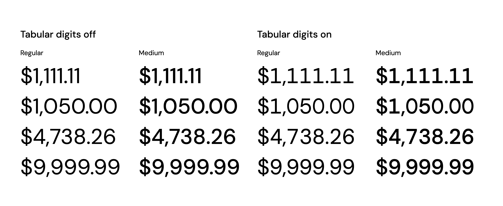

# DM Fonts

This repository contains for DM suite of fonts: Sans, Serif Text and Serif Display.

# LawnStarter Fork

This fork of [googlefonts/dm-fonts](https://github.com/googlefonts/dm-fonts) publishes DM Sans with tabular digits that line amounts up in a column. The fonts keep the family name DM Sans, so the release installs in place of the Google Fonts copy.

## Why This Fork Exists

DM Sans is the typeface of the LawnStarter design system, and the files Google Fonts distributes have no tabular digits, so amounts set in a column do not line up (the [request for them](https://github.com/googlefonts/dm-fonts/issues/25) is open upstream). The fork gives DM Sans the digits of DM Mono, its companion family, behind the tabular figures feature, so amounts align without a second typeface beside the text. The image below sets the same four amounts with the feature off and on.



## What the Release Holds

The release holds every weight of DM Sans, upright and italic, static and variable, as TrueType and WOFF2 files. The file [FONTLOG.txt](FONTLOG.txt) records what differs from upstream:

- With the tabular figures feature (`tnum`) on, every digit takes the same width and nothing else changes: the punctuation keeps its width and no glyph kerns against a digit.
- In Light, Regular and Medium, upright and italic, the digits one to nine are those of [DM Mono](https://github.com/googlefonts/dm-mono), whose copyright notice those fonts carry, and the zero is the plain zero of DM Sans at the same width. Those ten digits have no TrueType hinting.
- The other weights and the variable fonts keep the tabular digits upstream draws.
- The version string of each font ends with `;lawnstarter` and the release version.

## Turning the Tabular Digits On

- In Figma, select the text, open the type details and turn tabular numbers on.
- On the web, set `font-variant-numeric: tabular-nums`.
- In React Native, set `fontVariant: ['tabular-nums']`.

## Building

The build needs [uv](https://docs.astral.sh/uv/).

```sh
uv run pytest
uv run scripts/build_release.py <version>
```

The build writes the fonts and `DMSans-<version>.zip` to `dist/`.

## Releasing

Every merge to `main` runs the [Release workflow](.github/workflows/release.yml), where [release-please](https://github.com/googleapis/release-please) opens a release pull request with the next version and the changelog. Merging that pull request creates the tag and the GitHub release, with `DMSans-<version>.zip` attached. A repository admin merges it, since the required check does not run on a pull request the workflow opens.

For Figma, an organization admin uploads the fonts as a [shared font](https://help.figma.com/hc/en-us/articles/4403175325719-Manage-conflicting-fonts), which takes precedence over the Google Fonts copy.

# DM Serif

The [Serif](Serif) families are derived from [Source Serif Pro](https://github.com/adobe-fonts/source-serif-pro).


# DM Sans
The [Sans](Sans) family is derived from [Poppins](https://github.com/itfoundry/Poppins).


The type design and font development was commissioned from [Colophon Foundry](https://www.colophon-foundry.org), with Creative Direction from [MultiAdaptor](https://multiadaptor.com) and the DeepMind team.

These fonts are not officially supported Google products.

## License

All fonts are licensed under the [SIL Open Font License](https://scripts.sil.org/ofl).
